# 003 — Flim visual refresh (design)

Companion to `003-flim-visual-refresh.md`. **Replay-canonical** with that decision: later platforms (e.g. Android after iOS) implement this product design, not a parallel one.

## Context

A visual patch on top of the existing Element X design system (Compound), applied **across the whole app**. The mocks and the screen sections below define the language on the key screens (conversation list, room, space, tab bar), and "Applying across the app" maps it to every other screen. It changes colours and component styling. It does **not** rearrange screens or change the navigation model: no new popups, sheets, overlays, panels or transitions beyond decision 001, and every screen keeps its upstream presentation (push, sheet, full-screen, popover).

- **Narrow (compact) layouts:** layout and navigation follow decision 001 (room/space popup over the list, bottom strip, no back chevron on the join).
- **Wide (regular / split) layouts:** navigation stays upstream (per 001), but the same visual language applies. See "Wide / split layouts".
- Where 001's design gave visual detail (canvas tone, strip look, row furniture), this document is the source of truth.

Reference mocks (narrow, 390×844 pt @3x), light `L*` / dark `D*`, in [`003-flim-visual-refresh.assets/`](003-flim-visual-refresh.assets/):

| | Light | Dark |
|---|---|---|
| Conversation list | 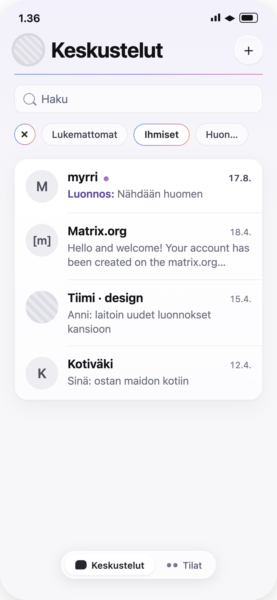 | 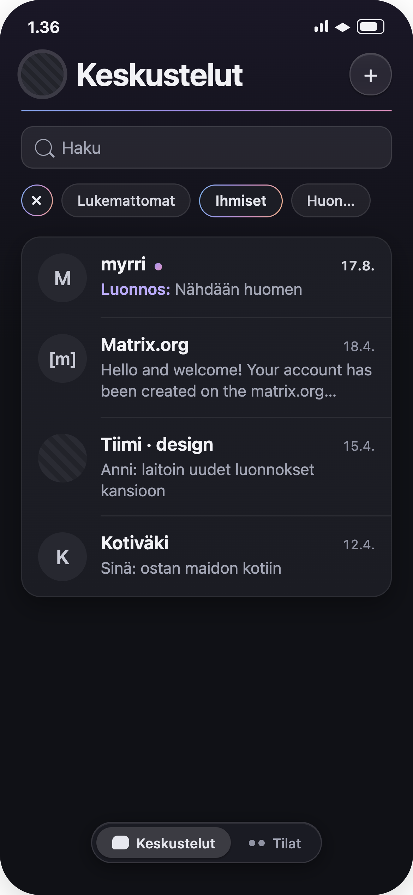 |
| Room, reading | 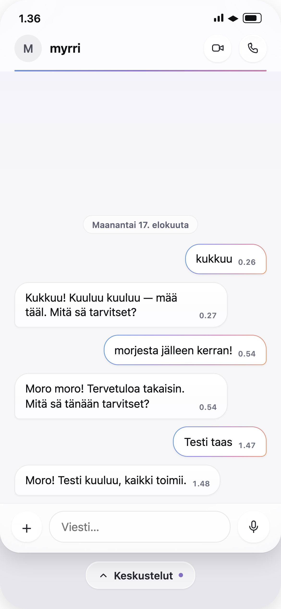 | 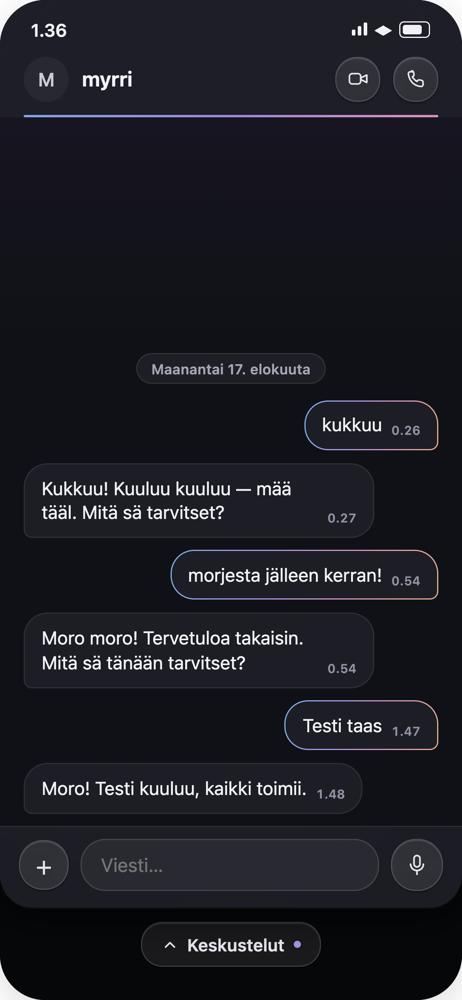 |
| Room, composing (keyboard up, Send visible) | 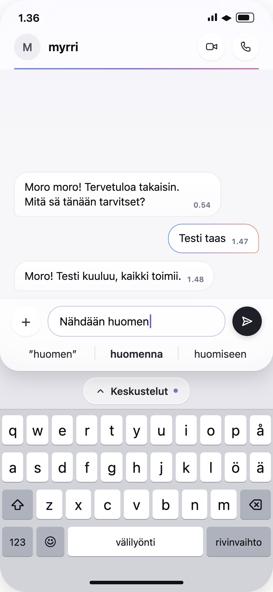 | 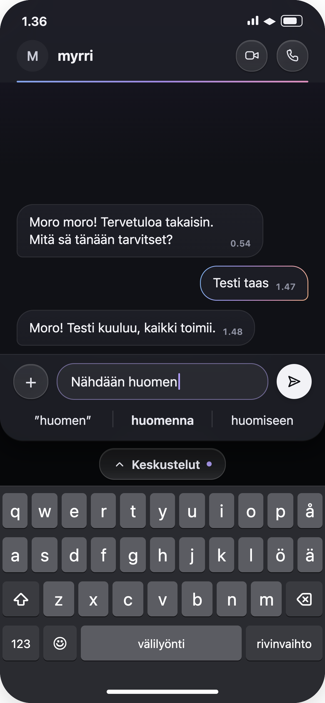 |
| Space | 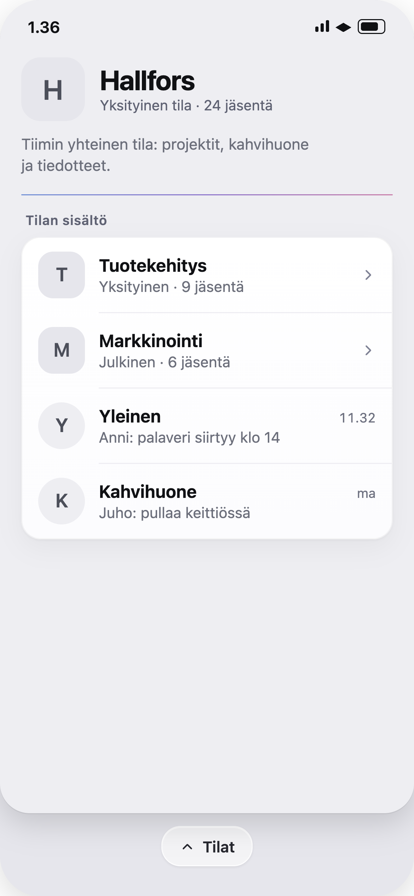 | 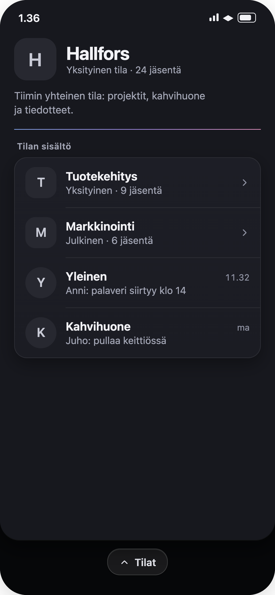 |
| Form sheet ("New space") | 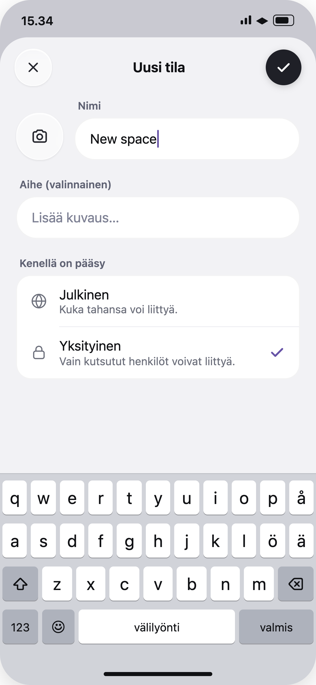 | 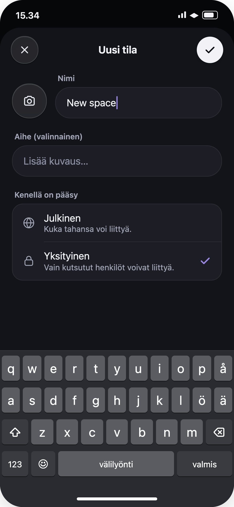 |
| Settings list ("Advanced settings", an inner push) | 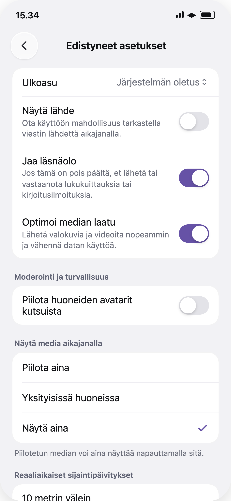 | 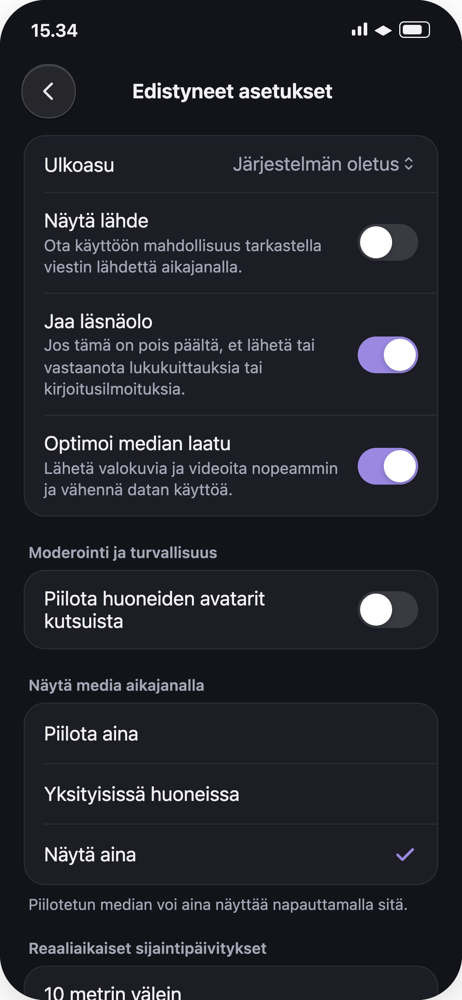 |

**The mocks are a style reference, not a content inventory.** Where a mock omits something upstream shows (header subtitle, badges, filters, the Search tab, sender names), the upstream element stays and is styled per this document. The mocks' unread dot placement and accent-coloured unread cues are superseded by "Unread and notification state" below.

## Product design

### Principles

1. **More air, clearer separation.** 20 pt horizontal screen margins. List rows sit inside a rounded, inset grouped card (iOS Mail-style) instead of running edge to edge.
2. **Colour is selective.** Surfaces, text and placeholder avatars are neutral. Colour marks only **selection and control state**, **draft**, and the **signature line**. Unread is carried by contrast and weight, **not** by the accent.
3. **Three fill classes, kept apart.** Everything else stays glass or neutral.

   | Class | Treatment | Applies to |
   |---|---|---|
   | **Primary action** | Solid `primary.fill` with a `primary.onFill` glyph / label (near-black in light, near-white in dark). Never the accent. | Send, the confirm (✓) in sheet headers, primary buttons in forms and dialogs |
   | **Platform state control** | `control.accent` fill / tint (replaces Element green) | Toggle on-track, checkmarks, radio selection, slider fill, text cursor / caret, focused-field tint |
   | **In-content selection** | Rainbow outline, no fill | Active filter pill, filter-clear (×), own message bubbles, the open conversation in a split-view sidebar |

   Neither the primary fill nor its glyph is pure black or pure white.
4. **Liquid-glass secondary controls.** Secondary circular buttons, the search field, the tab bar (where the system provides it) and the strip pill are translucent glass, never tinted with the accent.
5. **Gradients are barely there.** Surfaces and buttons change at most ~2% lightness top → bottom. The only visible gradients are the rainbow line and the rainbow outline.
6. **Nothing is lost.** Every upstream piece of information, indicator and control on a restyled screen remains, and states that upstream distinguishes by colour remain distinguishable (by neutral contrast, weight, shape or outline if the colour goes away). If a styling rule here would hide or merge an upstream cue, the cue wins.

### Tokens

| Token | Light | Dark |
|---|---|---|
| canvas (list + room) | `#f7f7f9` with top tint `oklch(0.962 0.014 292)` fading out by 38% height | `#101116` with top tint `oklch(0.215 0.03 292)` fading by 38% |
| canvas.space | `#eeeef2`, no tint (one neutral step from the room canvas) | `#17181e`, no tint |
| surface (cards, bubbles) | `#ffffff → #fcfcfe` | `#1d1e26 → #1b1c23` |
| surface.border | `rgba(16,17,20,.05)` | `rgba(255,255,255,.07)` |
| surface.shadow | `0 1 2 /.04, 0 8 24 /.05` | `0 8 24 rgba(0,0,0,.35)` |
| divider | `#eeedf2`, 1 pt, inset to text start (74 pt) | `rgba(255,255,255,.07)` |
| text.primary | `#101114` | `#f2f2f6` |
| text.secondary | `#6c6f7b` | `#a3a6b5` |
| text.timestamp | `#6e7180` | `#9093a3` |
| unread.strong (notifying unread: dot, mention, count badge fill, timestamp) | `#3f4150` | `#d6d7e0` |
| unread.soft (quiet / non-notifying unread) | `#b4b6c0` | `#5b5e6b` |
| icon | `#26272e`, 1.7 pt stroke, **outline only** | `#e6e7ee` |
| avatar.initials bg / fg | `#eeeef2` / `#4c4f5a` | `#272830` / `#c9cbd6` |
| accent (strip caret, draft label) | `oklch(0.60 0.12 292)`; draft text `oklch(0.46 0.13 292)` | `oklch(0.72 0.12 292)`; draft `oklch(0.78 0.11 292)` |
| strip / peek surface | `#e6e6ec` | `#060709` |
| primary.fill | `#1f2027` | `#f2f2f6` |
| primary.onFill | `#ffffff` | `#101116` |
| primary.shadow | `0 2 8 rgba(0,0,0,.18)` | same |
| control.accent (state controls, cursor, focused-field tint) | `oklch(0.50 0.13 292)` | `oklch(0.68 0.13 292)` |
| control.off (toggle track off) | `#e3e3e8` | `#3a3b42` |
| control.track (slider rest) | `#e6e6ec` | `#33343c` |
| control.knob | `#ffffff` + `0 2 5 rgba(0,0,0,.2)` | same |
| sheet.canvas | `#f2f2f5` | `#131419` |
| sheet.dim (behind a sheet) | `#c9c9d1` | `#060709` |

Semantic upstream colours (critical / error, success, verification, info, destructive) are not the accent and stay as upstream.

The canvas difference between room and space (violet top tint vs. flat neutral, one step apart) is the "quiet canvas-tone shift" that 001 asks for. It is reinforcement only; structural cues stay primary.

### Signature gradients

- **Rainbow line** (header accent): `linear-gradient(90deg, oklch(.66 .11 265), oklch(.62 .13 295), oklch(.68 .11 345))`. Dark: lightness +0.06. 1.5 pt tall, 20 pt side insets, rounded ends. Narrow hue range (blue → violet → rose), low chroma.
- **Rainbow outline** (selection): `linear-gradient(105deg, oklch(.68 .11 250), oklch(.66 .12 292), oklch(.68 .11 340), oklch(.76 .10 55))`. Dark: lightness +0.06. 1.5 pt stroke around a surface-coloured fill.

### Glass

- Light: fill `white @ 55%`, background blur ~14 pt, 1 pt border `white @ 85%`, inner top highlight `white @ 90%`, shadow `0 1 2 black @ 8%`.
- Dark: fill `white @ 8%`, border `white @ 14%`, inner highlight `white @ 10%`.
- **Never tinted with the accent.**
- **Reduce Transparency / Increase Contrast:** glass becomes an opaque surface (`surface`) with a visible border; text and icons keep their contrast. Glass is never the only thing separating a control from what is behind it.

### Typography

System font. Sizes below are at the default text size and **scale with Dynamic Type**. Large title 30 pt bold, tracking −0.8. Space title 26 pt bold. Row name 17 pt semibold (650). Preview 15 pt regular, 2-line clamp. Timestamp 12.5 pt with tabular digits. Bubble text 15.5 pt, bubble time 10.5 pt semibold.

### Conversation list (L1 / D1)

- **Header:** own avatar 40 pt (hairline ring), large title, glass "+" button 38 pt (glass, not filled). Any other upstream header controls remain, styled as glass.
- Rainbow line 14 pt below the title row.
- **Search:** glass field, 38 pt high, radius 11.
- **Filter pills:** the **upstream filter set and behaviour are unchanged**: same filters, same ordering (active filters lead), same leading clear (×) button when filtering, and no "All" pill (matching upstream). Restyle only:
  - Pills: radius full, 7×14 padding, 13.5 pt. Inactive: glass-ish fill, hairline border.
  - Active pill: **rainbow outline** instead of a filled pill.
  - Clear (×): 30 pt circle with the same rainbow outline (instead of upstream's filled accent circle); keeps its accessibility label.
- **Rows:** inside one grouped card (radius 18), avatar 46 pt, row padding 15 / 14 pt, inset dividers. All upstream row content stays: name, status emoji, last-message preview, sending / failed indicators (failed keeps the critical colour), timestamp, call badges, mute, mention, unread dot / count badge. Invite and knock cells keep their content and actions, restyled with the same card.
- **Draft:** when a room has a draft (cue from 001), the preview is replaced by **"Draft:"** in the accent colour followed by the draft text.
- **Avatars:** placeholder (initials) avatars are neutral: no per-user colours. Image avatars are unchanged.
- **Tab bar:** see "Tab bar".

### Unread and notification state

Upstream distinguishes, on the row's **trailing** side: a dot (or count badge when the count setting is on) for unread, a mention icon, a mute icon and call icons. It also distinguishes **notifying** unread (accent colour, semibold timestamp) from **quiet** unread (grey dot). All of that stays, with the accent removed:

- The **unread dot stays on the trailing side** of the row (after the timestamp column, aligned with the preview line), **not** next to the name.
- **Notifying unread** (upstream "highlighted"): dot, mention icon and count badge in `unread.strong`; the timestamp turns `unread.strong` semibold. Count badge: `unread.strong` capsule with inverted (canvas-coloured) text.
- **Quiet unread** (upstream non-highlighted): dot in `unread.soft`; regular timestamp.
- Mute and call icons: `text.secondary`, unchanged in meaning.
- Name / preview weight follow upstream's room-list activity visibility setting unchanged.
- Accessibility labels for all indicators stay as upstream. Colour is never the only channel.
- The same rule applies to every other unread cue this decision touches: the **strip** unread-elsewhere dot is `unread.strong`, and **tab** badges are neutral (`unread.strong` fill, inverted text) rather than the accent.

### Room (L2 / D2, L3 / D3)

- **Popup panel (narrow only):** bottom corners 28 pt, shadow onto the strip. Dark mode adds a 1 pt `white @ 7%` lip under the panel because shadows vanish on black.
- **Header bar:** near-opaque surface (`white @ 72%` + blur; dark `#1e1f27 @ 86%`). The rainbow line sits on the bar's bottom edge.
  - Contents: avatar 38 + name, plus **everything upstream shows there**: status emoji, verification badge, history-sharing icon, and the **subtitle** (presence / encryption / other upstream subtitle text) when upstream provides one. The mocks show a DM with no subtitle; that is not a removal.
  - Trailing actions (call, video, and any other upstream toolbar items) as glass circular buttons with outline icons.
  - Back chevron: per 001 on narrow (none on the join); per upstream on wide.
- **Banners above the timeline** (pinned messages, upgrade / tombstone, verification, etc.) stay, restyled on `surface` with `surface.border`.
- **Bubbles:**
  - Both sides use the surface colour, radius 20 with a 7 pt tail corner. Timestamp inside the bubble.
  - Others: hairline `surface.border`.
  - **Own messages: rainbow outline**, no fill.
  - **Sender names** (group rooms) keep **upstream per-user colours**. Sender avatars in the timeline follow the neutral placeholder rule above; image avatars unchanged.
  - Every upstream bubble state and decoration stays distinguishable: replies / quotes, threads, edits, reactions, read receipts, sending / failed state, encryption / authenticity shields, highlighted (mentions you) and focused / permalinked messages. If upstream marks one of these with a fill or the accent, use a neutral surface step or an outline instead; never drop it.
- **Date separator:** small glass chip, centred.
- **Composer:** same bar surface as the header. Glass "+" (40), field radius 21; upstream edit / reply / formatting states are kept. Focused field border is `control.accent @ 45%`, caret `control.accent`.
- **Trailing control (mic ↔ Send):** as upstream, the glass **mic** (42) shows while the field is empty and swaps to **Send** once there is text.
  - Send: 42 pt circle in the primary-action class (`primary.fill`, `primary.shadow`), with a right-pointing **paper plane** as a 1.9 pt outline (not filled) in `primary.onFill`.
  - Same position and size as the mic, so the swap doesn't shift layout; crossfade ~120 ms (instant with Reduce Motion).
  - Upstream's other Send modes keep their meaning in the same primary style, e.g. the edit-confirm glyph when editing a message. Disabled Send uses the glass treatment with a secondary-colour glyph.
- **Keyboard up (narrow),** top to bottom: panel → composer → suggestion / dictation bars (with the panel) → strip → system keyboard (per 001).

### Strip (narrow only)

- Full-width band on the peek surface, 78 pt (keyboard down, includes home-indicator inset) or 54 pt (keyboard up).
- Centred glass pill, 36 pt high: upward caret (accent) + destination label (per 001: the immediate parent's title), plus a 6 pt `unread.strong` dot when there is unread elsewhere.

### Space (L4 / D4)

- Canvas uses `canvas.space`. Hero: 60 pt rounded-square avatar (radius 18), name 26 pt, visibility + member count, topic, and any other upstream hero content / actions (join, settings, etc.).
- Rainbow line under the hero.
- **Children in a grouped card**, row furniture per 001:
  - Sub-space rows: rounded-square avatar (radius 14), visibility + member count, trailing chevron.
  - Room rows: circular avatar, last-message preview + time, no chevron.
  - Unjoined rows keep upstream's join affordance; unread state on joined rows follows "Unread and notification state".

### Form sheets (L5 / D5)

Applies to every sheet that upstream already presents (create room / space, edit details, report, invite, polls, etc.). The presentation itself is upstream's; only its look changes.

- **Sheet:** top corners 34 pt on `sheet.canvas`; the screen behind is dimmed towards `sheet.dim`.
- **Header controls keep upstream's content.** Upstream's toolbar button shows an icon on iOS 26 (close / check / delete, with the action's word as its accessibility label) and the **word itself** on earlier iOS. Follow that per version; never replace a word upstream shows with a glyph.
  - **iOS 26:** glass close (✕) 44 pt leading; trailing confirm is the primary-action ✓, 44 pt. While the form is invalid / confirm is disabled, the ✓ is glass with a secondary-colour glyph, same size. Both carry upstream's action words as their accessibility labels (e.g. "Cancel", "Create").
  - **Earlier iOS:** the upstream words, restyled: close/cancel as a glass capsule with the word, confirm as a primary-action capsule with the word (e.g. "Create", "Save", "Done", "Report", "Invite").
  - Destructive confirms keep the critical colour in both cases, with upstream's content (delete glyph on iOS 26, the word earlier).
- **Avatar picker:** 56 pt glass circle with an outline camera icon.
- **Field labels:** 13 pt semibold, secondary colour, 4 pt inset from the field.
- **Text fields (forms):** capsule, 50 pt high, `surface` fill, hairline `surface.border`; caret `control.accent`. Search fields stay glass (see "Conversation list").
- **Option lists** (e.g. access / visibility): grouped card. Each row has a leading outline icon (22 pt, secondary colour), title and subtitle. The selected row gets a trailing **checkmark in `control.accent`**, with no row fill or highlight.

### Settings and other lists (L6 / D6)

Applies to settings and every other grouped list / form screen (room and space details, notification settings, roles and permissions, security and privacy, etc.).

- **Back control** on these pushes (001's inner stack, and every push on wide layouts): upstream's back control, restyled as a 44 pt glass circle with an outline chevron. 001's strip and chevron removal do not apply here.
- **Lists:** grouped cards (radius 18) with inset dividers, 20 pt screen margins, section headers in the field-label style; footnotes 13 pt secondary under the card.
- **Toggles:** standard platform size (iOS 51×31). On = `control.accent` track, off = `control.off`; the knob is always `control.knob` (white), never tinted.
- **Single-choice lists:** a trailing `control.accent` checkmark on the selected row, with no radio circles (matching iOS).
- **Multi-select lists** (e.g. invite pickers): upstream's selection indicator in `control.accent`, with no row fill or outline.
- **Pickers / menus:** current value in secondary text plus an outline up/down chevron.
- **Sliders:** 4 pt track; filled part `control.accent`, rest `control.track`; 26 pt `control.knob` thumb with shadow; min / max labels in secondary text.

### Tab bar

- **iOS 26+:** the system floating glass tab bar, no accent tint (neutral selected segment = brighter glass).
- **Below iOS 26:** the system tab bar look as upstream; do not build a custom capsule.
- All upstream tabs stay, including **Search** when upstream shows it. Tab badges stay (neutral, see "Unread and notification state").

### Wide / split layouts

Same tokens, typography, glass, gradients and component styling as narrow. Only the narrow-specific pieces from 001 are absent.

- **Navigation and back chrome:** upstream (no popup, no strip, no container transform; back controls as upstream shows them in split view).
- **Sidebar / list column:** `canvas`, 20 pt margins, grouped card rows, header and filters as on narrow. Upstream's selected-row fill is replaced by the **rainbow outline**: a rounded rectangle drawn inside the card around the selected row, on the surface fill. Pointer hover / keyboard focus keep system feedback.
- **Detail column, room:** header bar with rainbow line, bubbles, banners and composer exactly as in "Room", without the popup panel's bottom corners, shadow and lip (they exist to sit over the strip). The composer sits on the bottom safe area as upstream.
- **Detail column, space:** `canvas.space`, hero, grouped children as in "Space".
- **Empty detail placeholder:** upstream content on `canvas`.
- **Column separation:** system divider between columns; columns may differ in canvas (e.g. room vs. space) without an extra border.
- **Tab bar / sidebar:** whatever the system provides for the size class (e.g. iPad top tab bar or sidebar) with no accent tint; no custom component.

### Applying across the app

Every screen we draw gets the full visual language, not just the colour tokens. That covers settings, room / space / user details, members, invites, start chat, search, media and file previews, polls, location, onboarding and authentication, app lock, sheets and pickers we own, 001's inner pushes, and app-extension UI. Each screen keeps its upstream layout, content and presentation. Its building blocks are restyled by kind:

| Upstream building block | Flim styling |
|---|---|
| Screen background | `canvas` (with top tint); space screens `canvas.space` |
| Lists and forms (grouped rows, settings rows, pickers) | inset grouped cards on `surface`, radius 18, 20 pt margins, inset dividers |
| Screen title / identity header (large titles, room / user / space details heroes) | typography above; rainbow line under the title area |
| Navigation and toolbar bars | system bar on `canvas`; back and toolbar icon buttons as 44 pt glass circles with outline icons |
| Sheet header confirm / cancel | per "Form sheets": upstream's icon on iOS 26 (glass ✕, primary-action ✓), upstream's word on earlier iOS |
| Primary call-to-action buttons (forms, dialogs, onboarding) | primary-action class: `primary.fill`, `primary.onFill` label, `primary.shadow`; never the accent |
| Secondary / tertiary / icon buttons | glass |
| Destructive buttons and actions | upstream critical colour, unchanged |
| Send button | primary-action class, per "Room" |
| Search fields | glass field, radius 11 |
| Form text fields | `surface` capsule per "Form sheets" |
| Composer field | radius 21 per "Room" |
| Segmented controls, chips, pills, tabs we draw | selected = rainbow outline |
| Toggles, checkmarks, radio / single-choice, multi-select indicators, sliders, text cursor, focused-field tint | platform state-control class: `control.accent` (replaces Element green); toggle off `control.off`, slider rest `control.track`, knobs / thumbs `control.knob`, never tinted |
| Badges and counters | neutral (`unread.strong` fill, inverted text) |
| Banners, toasts, loading / user indicators | glass pill or `surface` card with `surface.border` |
| Sheets we present | `sheet.canvas`, 34 pt top corners, `sheet.dim` behind; presentation style unchanged |
| Popovers and menus we draw | `surface` with `surface.border` and `surface.shadow` |
| Placeholder avatars | neutral initials everywhere; image avatars unchanged |
| Icons | outline style, `icon` colour, except filled glyphs that carry state |
| Links in text | upstream link colour (semantic, not the accent) |

Every upstream use of Element's accent colour is mapped to one of the rows above: in-content selection → rainbow outline, platform state control → `control.accent`, unread → neutral, primary action → `primary.fill`. None is left as Element's accent. Screens that are deliberately immersive upstream (full-screen media viewer, call UI chrome) keep their dark presentation but use these tokens and glass for their controls.

### Do not

- Fill Send, ✓ or primary buttons with the accent, `control.accent` or Element green.
- Mix the fill classes: no accent on primary actions, no `primary.fill` on state controls, no fills for in-content selection.
- Use solid accent fills on pills, bubbles or badges.
- Use the accent for unread.
- Tint avatars, glass, the tab bar, toggle knobs or slider thumbs with the accent.
- Use filled icons, including the send plane (except where upstream uses a filled glyph to carry state, e.g. a solid call / mute badge; keep the meaning).
- Add the rainbow anywhere beyond the header line and selection outlines.
- Add strong gradients, or any gradient spanning more than ~2% lightness on surfaces.
- Remove or hide any upstream information, indicator or control to match a mock.
- Introduce new popups, sheets, overlays, panels or transitions, or change how any screen is presented, to match the look. Only decision 001 changes navigation.
- Leave a screen in Element's styling (including Element's accent) because it is not in the mocks.

## Platform notes

- iOS: implement mainly as Compound token and component-style overrides (`CompoundButtonStyle`, `CompoundToggleStyle`, `ListRow` / `.compoundList()`, `SearchFieldStyle`, `SendButton`, accent tints) so the look reaches every screen without forking screens. Use per-screen changes only where a screen draws its own styling.
- iOS fill classes: primary action via `CompoundButtonStyle` `.primary` and `SendButton`; state controls via `CompoundToggleStyle` / `ListRow` tints (currently `iconAccentTertiary`) and the global `.tint`; sheet header ✕ / ✓ via the existing `.cancellationAction` / `.confirmationAction` toolbar items.
- iOS sheets: keep system sheet presentation. If the system dimming colour cannot be set, accept system dimming rather than building a custom presentation (that would be a navigation change).
- iOS glass: `.glassEffect()` on iOS 26, `.ultraThinMaterial` + hairline stroke below; honour `accessibilityReduceTransparency` / `colorSchemeContrast` with an opaque fallback.
- iOS rainbow outline: stroke a `RoundedRectangle` with a `LinearGradient`.
- iOS upstream hooks: `HomeScreenRoomCell` (trailing badges, `isHighlighted` → `unread.strong`), `HomeScreenRoomCellButtonStyle` (selection), `RoomListFiltersView` / `RoomListFilterView`, `RoomHeaderView`, `PlaceholderAvatarImage` (neutral initials), `TimelineItemBubbledStylerView` (sender name keeps `decorativeColor`), `NavigationTabCoordinator.configureAppearance` (badge colour).
- Android (replay): Material 3 surfaces for glass where no blur is available; same token values and rules.

## Open issues

_(none)_

## History

- 2026-10-13: first write (from the visual patch at `specs/temp/`). Patch adjusted so it drops nothing from upstream: filters and header subtitle / badges kept, unread dot on the trailing side, unread neutral (no accent), tab bar system look below iOS 26, sender names keep per-user colours, only placeholder avatars go neutral; wide / split layouts planned with the same visual language
- 2026-10-13: app-wide scope made explicit ("Applying across the app": building-block mapping incl. primary / send buttons neutral, toggles / checkmarks in the Flim accent, every Element-accent use remapped); no navigation-model change beyond 001 restated in Context and "Do not"
- 2026-10-13: patch 2 (`specs/temp2/`) folded in: three fill classes (primary action / platform state control / in-content selection) replace "no fills for selection"; new tokens (`primary.*`, `control.*`, `sheet.*`), with `control.accent` separate from the draft / caret `accent`; Send spec (mic ↔ Send swap, outline plane, primary fill); new "Form sheets" (L5 / D5) and "Settings and other lists" (L6 / D6) sections; L3 / D3 replaced by the Send-visible mocks. Adjusted so nothing is lost: confirms keep upstream's content (icon on iOS 26 with the word as the accessibility label, the word itself on earlier iOS); multi-select uses the state-control accent instead of a row outline
- 2026-10-13: sheet confirms follow upstream per OS version — the word wherever upstream shows the word (earlier than iOS 26), the ✓ only where upstream shows the icon (iOS 26)
